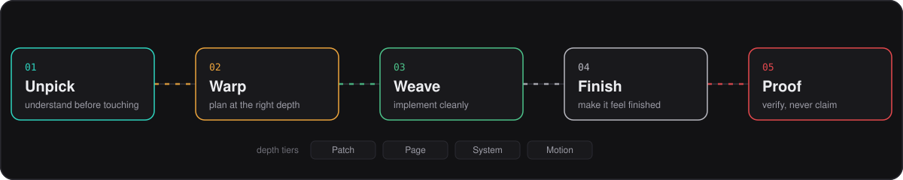

<div align="center">
  
  <br/><br/>
  <a href="#the-method-five-passes"></a>
  
  
  
  
</div>

<br/>

**Weftline** is a cross-agent skill for building thoughtful, accessible, responsive, and production-quality web interfaces. It gives compatible coding agents a research-backed working method: understand an interface task, plan it at the right depth, implement it cleanly, add purposeful motion, and prove the result instead of claiming it.

This repository is one folder with two parts:

| Part | What it is | Where it lives |
|---|---|---|
| **The skill** | An installable AI skill in the [Agent Skills](https://agentskills.io) open format. Point a compatible coding agent at it and it works. | [`weftline/`](weftline/) |
| **The website** | The project site: a Next.js 16 application presenting the method, with the validated skill available as a download. | [`src/`](src/) |

<br/>

<div align="center">
  
</div>

<br/>

## The method: five passes

Every task moves through the same fixed sequence. The sequence scales from a one-line fix to a multi-component system, because the depth changes, never the order.

| Pass | Focus | The question it answers |
|:---:|---|---|
|  | Read the real task | What is actually being asked, and what already exists here? |
|  | Plan at the right depth | How much architecture does this task honestly deserve? |
|  | Implement cleanly | Is this code consistent, accessible, and responsive by default? |
|  | Make it feel finished | Do states, edges, and transitions hold up under real use? |
|  | Verify, never claim | What evidence shows the result works, in a real browser? |

## Depth tiers

The Warp pass assigns one of four depth tiers, so small fixes stay small and complex work gets real architecture.

| Tier | Applies to | Weight |
|:---:|---|:---:|
|  | Isolated fixes inside existing structure | Minimal |
|  | A full page or view, composed from established patterns | Standard |
|  | Multi-component systems that set patterns others follow | Full |
|  | Work where animation is a stated requirement | Specialist |

## The motion ladder

Animation technology is chosen deliberately, climbing only when the task justifies it:

1. **CSS transitions** for state changes: hover, focus, open, closed.
2. **The Web Animations API** when CSS runs out: sequencing, playback control.
3. **A purpose-chosen library** (Anime.js, Motion) only when its capabilities justify the dependency.

Every animation must pass a purpose test and respect `prefers-reduced-motion`.

<br/>

## Install the skill

```bash
# clone this repository
git clone https://github.com/izynu/weftline.git
cd weftline

# copy the skill folder into your agent's skills directory
cp -R weftline /path/to/your-agent/skills/
```

The skill ships as plain markdown plus one validation script, so installation is a folder copy. Agent coverage and install paths for specific products are documented in [`weftline/references/compatibility-and-installation.md`](weftline/references/compatibility-and-installation.md).

Confirm the package is intact:

```bash
python3 weftline/scripts/validate_skill.py
```

Expected final line: `Result: PASS` across all checks.

<br/>

## The website

The site presents the method and serves the validated skill as a download. It is a full Next.js application, not a static page.

| | |
|---|---|
| **Framework** | Next.js 16, App Router, TypeScript 5 |
| **Styling** | Tailwind CSS 4 with shadcn/ui components |
| **Data** | Prisma ORM with SQLite |
| **Theme** | Dark grey surfaces, amber primary, flat colors, rectangular controls |
| **Motion** | Purposeful transitions only, reduced-motion respected |

Run it locally:

```bash
npm install        # or: bun install
npm run db:push    # create the SQLite database from the Prisma schema
npm run dev        # start on http://localhost:3000
```

<br/>

## Hosting

The website deploys itself to GitHub Pages, so GitHub is the only platform involved.

1. Repository **Settings** → **Pages** → set **Source** to **GitHub Actions** (one time only).
2. Every push to `main` then runs two workflows: the skill validator and the site build. The site goes live at `https://izynu.github.io/weftline/` about a minute later.

The build is a fully static export of the Next.js site, produced by `.github/workflows/deploy.yml` with `BUILD_STATIC=1`. Download buttons on the hosted site link to GitHub's own repository archive, so the latest version is always one click away.

<br/>

## Repository structure

```
weftline/
├── README.md               this file
├── LICENSE                 MIT
├── .github/
│   └── workflows/          CI: validates the skill on every push
├── docs/
│   ├── banner.svg          animated banner
│   └── pipeline.svg        animated method pipeline
├── src/                    the Next.js website
│   ├── app/
│   ├── components/
│   ├── hooks/
│   └── lib/
├── prisma/                 database schema
├── public/                 static assets
└── weftline/               the installable skill
    ├── SKILL.md            the skill entry point
    ├── README.md
    ├── references/         design principles, motion, accessibility, compatibility
    ├── examples/           good workflow and anti-patterns
    ├── scripts/            validate_skill.py
    └── .github/            templates for the skill repository
```

<br/>

## Validation

The skill package carries its own validator, and this repository runs it on every push through GitHub Actions, so the published package is always the verified one.

```bash
python3 weftline/scripts/validate_skill.py
```

The script checks structure, frontmatter compliance with the Agent Skills specification, internal links, cross-document consistency, secret patterns, and editorial rules. It reports each check and exits nonzero on any failure.

<br/>

## Maintainers

| | Role |
|---|---|
| **Zynu** ([@izynu](https://github.com/izynu)) | Primary maintainer and main developer |
| **Shraddha** ([@xhraddha](https://github.com/xhraddha)) | Contributor: research, implementation, documentation, testing, review |

<br/>

## License

[MIT](LICENSE). Copyright (c) 2026 Zynu and contributors (Shraddha).
